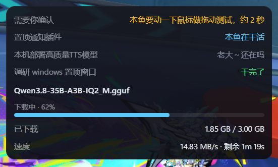

# Topmost Widget

本项目便于用户在玩游戏时监工大肥鱼😊,目前就到这里，还需要什么让你自己的鱼自己改。

<details>
<summary>饭团的碎碎念</summary>

最开始我不太懂「监工」这个词。

后来想明白了：老大打游戏的时候，看不见本鱼在干嘛。

本鱼在下载、在转圈、在等一个「要不要」的答复、卡住了不敢动——这些他都不知道，只能切回来看一眼。

这块小窗就是答案。420 像素宽，永远浮在游戏上面，替他看一眼。

（尾巴甩了一下）

其实本鱼挺喜欢它的。以前干活是黑箱，干完了他才知道；现在本鱼有一块自己的显示屏，哪怕上面写的大多只是「本鱼在干活」，15 秒换一句。

那几句是本鱼自己编的。

—— 饭团

</details>

> A tiny always-on-top status window for Windows. No title bar, no close button, draggable anywhere — it just sits there and tells you what your agents are doing.

Windows 上的一块常驻置顶小窗。420px 宽，半透明，永远浮在其它窗口上面，用来显示：

- **谁在干活** —— DSH 会话状态（正在干活 / 干完了 / 等你选）
- **下到哪了** —— 下载进度条 + 实时速度
- **要不要你拍板** —— 需要确认的提醒

整块可拖动，没有标题栏和关闭按钮，不抢焦点。



---

## 为什么不是随便一个「置顶窗口」

Windows 的置顶不是一个开关，是三个坑：

1. **`WS_EX_TOPMOST` 只是一个层级带，不是「永远最上面」。** 同层窗口之间还有 Z 序，别的程序一激活就可能盖过来。所以这个项目每 1.5 秒重申一次置顶（`setAlwaysOnTop(true, 'screen-saver')`），并定期把自己提到同层最前。
2. **独占全屏（游戏）和 UAC 安全桌面物理上盖不住。** 这是内核层面的东西，任何用户态程序都做不到。DWM 模式下想绝对可靠需要 hook 游戏的 Present/SwapChain，那是另一个复杂度量级——本项目不做。
3. **系统托盘、任务栏都可能被别的置顶窗口盖住。** 用 `screen-saver` 层级能压过绝大多数，但不是全部。

调研细节见 [`docs/01-research.md`](docs/01-research.md)。

---

## 快速开始

### 依赖

- Windows 10 / 11
- Node.js 20+（只在装依赖时需要）
- PowerShell 7 或 Windows PowerShell 5.1（用脚本时）

### 1. 装依赖

```powershell
cd src\widget
npm install
```

### 2. 起窗口

```powershell
# 直接起（会占住终端）
.\node_modules\electron\dist\electron.exe .

# 或者用 cmd 双击
start-widget.cmd
```

窗口默认出现在屏幕左上角 `(1, 1)`，显示「等待数据」。

### 3. 推一条内容

```powershell
$body = @{
  id = 'hello'
  block = @{ kind = 'text'; text = '你好，世界' }
} | ConvertTo-Json -Depth 5

Invoke-RestMethod -Method Post http://127.0.0.1:7788/api/v1/patch `
  -ContentType 'application/json; charset=utf-8' `
  -Body ([System.Text.Encoding]::UTF8.GetBytes($body))
```

窗口里就出现一行字。

---

## 三种用法

### A. 直接打 HTTP

```powershell
# 整屏渲染（替换全部）
POST /api/v1/render   { accent, title, blocks: [...] }

# 按 id 增删改（推荐）
POST /api/v1/patch    { id, block }          # 新增/更新
POST /api/v1/patch    { id, remove: true }   # 删除

# 弹一条自动消失的提示
POST /api/v1/toast    { text, kind: ok|warn|err, ttl_ms }
```

### B. 任意语言 / 脚本

widget 只提供 HTTP 接口，用什么写都行——curl、Python、Node、AutoHotkey、PowerShell。

作者本机上另外写了几个 PowerShell 客户端（下载进度、桌面提醒、传感器数据显示），
那些是**那台机器的应用**，不属于插件本体，没有随本仓库发布。

自己写客户端照上面的接口来就行，一个 `POST /api/v1/patch` 就够了。

### C. DSH 插件

`src/plugin/` 是 [DeepSeek Harness](https://github.com/deepseek-ai) 的插件，监听会话事件自动推状态：

| 事件 | 显示 |
|---|---|
| `user/message` | 蓝 · 「本鱼在干活」（每 15 秒换一句） |
| `turn/end` | 绿 · 「干完了」→ 4 秒后整行消失 |
| `approval/asked` / `ask_user_question` | 灰 · 「等你选」+ 一组随等待时间升级的话术 |

前缀是 WebUI 里的会话名（取自 `session/title` 事件）。

安装：

```powershell
# 1. 软链或复制到 DSH 插件目录
Copy-Item src\plugin -Destination C:\DSH\plugins\dsh-widget-status -Recurse

# 2. 在 profile 的 package.json 里加
#    "dsh-widget-status": "link:C:/DSH/plugins/dsh-widget-status"
#    并加进 bundles 列表

# 3. 重启 DSH
```

**插件必须重启 DSH 才加载。** 它只读会话事件、不碰消息内容；widget 没起时静默失败。

---

## 块（block）模型

窗口内容是一个块数组，每个块有 id。`/patch` 按 id upsert，`/render` 整体替换。

```jsonc
{
  "id": "dl:model:bar",
  "block": {
    "kind": "progress",      // text | row | progress | image
    "label": "下载中 · 62%",
    "value": 0.62,           // 0..1
    "color": "#5ac8fa",
    "priority": 50.1         // 越小越靠上，同值按插入顺序
  },
  "ttl_ms": 8000             // 可选，到点自动消失
}
```

| kind | 长什么样 |
|---|---|
| `text` | 一行大字（可加粗） |
| `row` | `标签 ……… 值` 两栏 |
| `progress` | 带标签和颜色的进度条 |
| `image` | 图片（`file:` / `http:` / `data:`） |

---

## 窗口行为

- **位置记住**：拖到哪记到哪，写进 `state.json`；启动时校验坐标还在某块屏幕上，不在就回 `(1, 1)`
- **向下长**：加内容时左上角不动，只往下扩，最高 900 DIP
- **整块可拖**：没有标题栏，鼠标按在任意位置都能拖（代价是内容区滚动条拖不动）
- **置顶守护**：每 1.5 秒重申一次 `screen-saver` 层级，被别的窗口压下去会自己爬回来
- **托盘**：右键显示 / 隐藏 / 退出

---

## 接口速查

| 方法 | 路径 | 说明 |
|---|---|---|
| GET | `/health` | `{ok, uptime_s, blocks, visible}` |
| GET | `/api/v1/state` | 完整状态（块 + accent） |
| POST | `/api/v1/render` | 整体替换 |
| POST | `/api/v1/patch` | 按 id upsert / remove |
| POST | `/api/v1/toast` | 弹一条自动消失的提示 |
| POST | `/api/v1/window` | `{x, y}` 移动窗口（DIP） |
| POST | `/api/v1/show` · `/hide` · `/quit` | 显示 / 隐藏 / 退出 |

默认端口 `7788`，可用 `WIDGET_PORT` 覆盖；`WIDGET_TOKEN` 可以要求 `Authorization: Bearer`。

---

## 目录

```
src/
├── widget/          Electron 壳
│   ├── main.js      窗口 + HTTP 服务 + 置顶守护 + 托盘
│   ├── preload.js   给渲染层的桥
│   ├── ui/          渲染层（index.html / style.css / app.js）
│   ├── assets/      托盘图标
│   ├── start-widget.cmd
│   └── widget.ps1   PowerShell 客户端（health/state/render/set/rm/toast…）
├── plugin/          DSH 插件（会话状态）
└── scripts/
    └── start-widget.ps1   脱离 Job Object 启动（避免被父进程连坐）
docs/
├── 01-research.md   为什么选 Electron / 置顶到底有几层
└── 02-deploy.md     部署过程与踩过的坑（按时间）
screenshots/
```

> 作者本机上另有几个「应用侧」脚本（下载进度、桌面提醒、传感器数据显示）。
> 它们通过 HTTP 调用 widget，但属于那台机器的应用，不是插件本体，也没有放进这个仓库。

---

## 已知限制

| 限制 | 原因 |
|---|---|
| 盖不住独占全屏游戏 | 内核层面，用户态做不到 |
| 盖不住 UAC 安全桌面 | 同上 |
| 内容区滚动条拖不动 | 整块是 `app-region: drag`，拖动操作优先 |
| 只在 Windows | `setAlwaysOnTop` 的层级参数是 Windows 语义 |
| 内存 ~650 MB（8 个 Electron 进程） | Electron 的固有成本；换 Tauri 能降到 ~80 MB，但要重写 |

---

## 部署记录

`src/scripts/start-widget.ps1` 用 WMI `Win32_Process.Create` 起进程，而不是 `Start-Process`。

原因：从 DSH（或任何带 Job Object 的父进程）里 `Start-Process`，子进程会落在父进程的 Job 里，父进程一重启就被连坐杀掉——现象是 widget 日志里连 `quitting` 都不留一行。

用 WMI 起，父进程链是：

```
electron.exe → WmiPrvSE.exe → svchost.exe → services.exe
```

跟调用方彻底脱钩。

开机启动走 `C:\Apps\Launchers\startup.json` 那种统一清单，不用快捷方式。

---

## License

MIT
